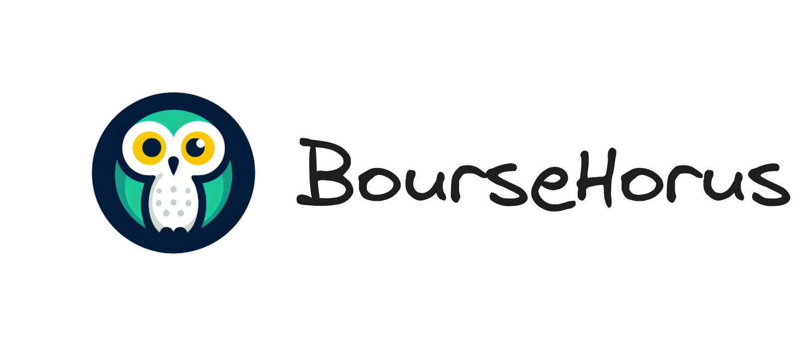

# Boursehorus

This is a [Next.js](https://nextjs.org/), [Tailwind CSS](https://tailwindcss.com/) app.

## Quick Start Guide

## Installation

```bash
pnpm install --frozen-lockfile
```

Use the pnpm version declared in `package.json`. `pnpm-lock.yaml` is the
dependency lockfile; do not generate an npm or Yarn lockfile.

Security checks: `pnpm audit`, `pnpm lint`, `pnpm exec tsc --noEmit`, and
`pnpm build`. The build runs TinaCMS before Next.js and requires the deployment's
Tina configuration. pnpm overrides in `pnpm-workspace.yaml` apply security fixes
to transitive parsers.

The November 2026 update removes the critical audit findings. TinaCMS still
depends on Zod 3 and Altair 7, which have published advisories. Replacing them
with a different major version requires upstream compatibility work; do not
force Zod 4 into TinaCMS solely to silence the audit. Keep the CMS development
server private and recheck these dependencies when updating TinaCMS.

## Development

First, run the development server:

```bash
yarn dev
```

Open [http://localhost:3000](http://localhost:3000) with your browser to see the result.
